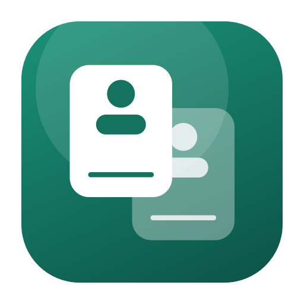
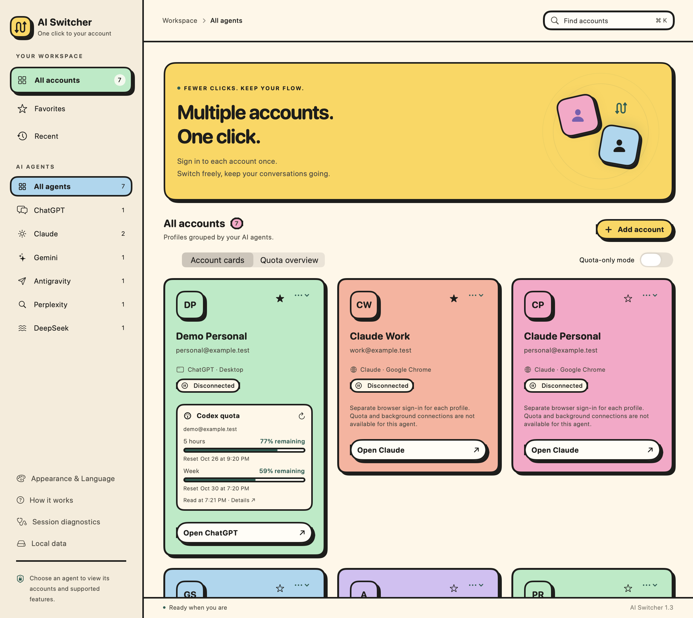
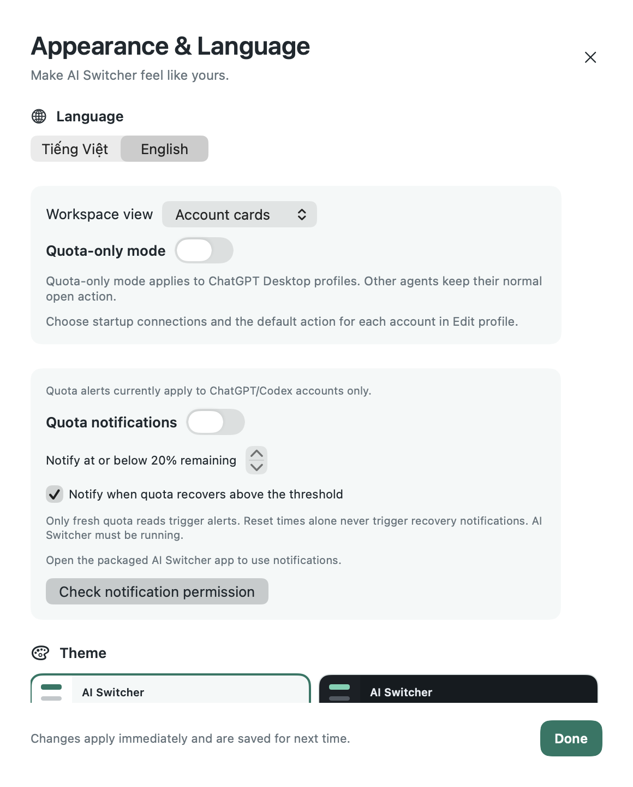
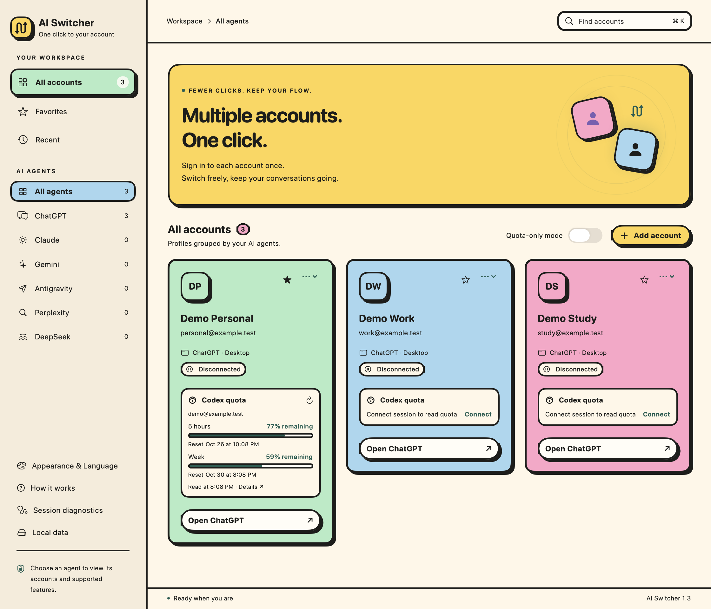
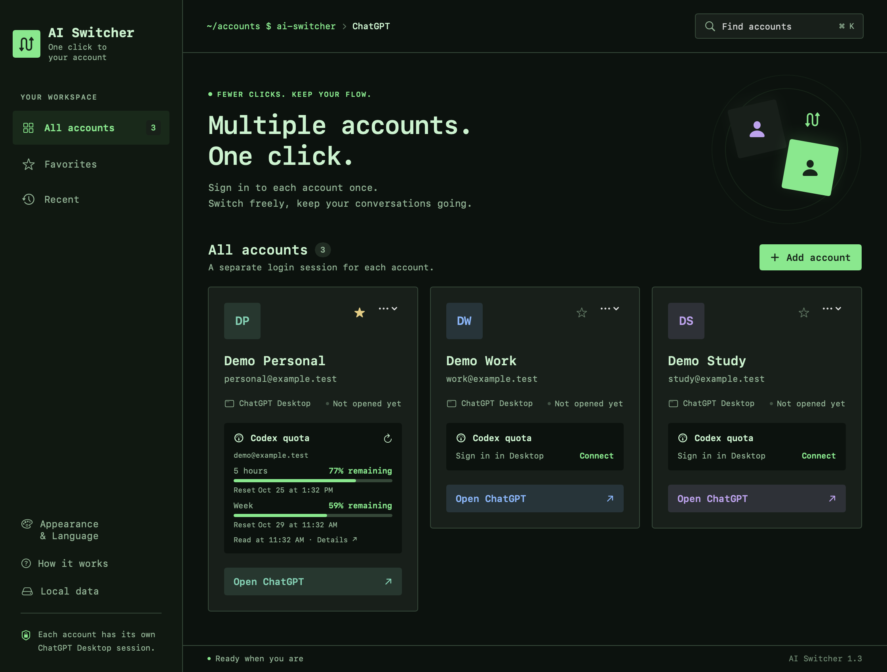
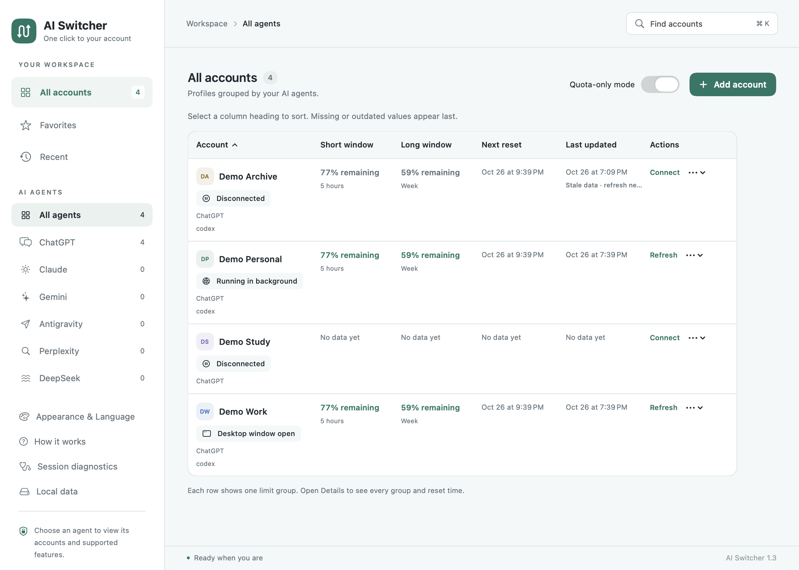
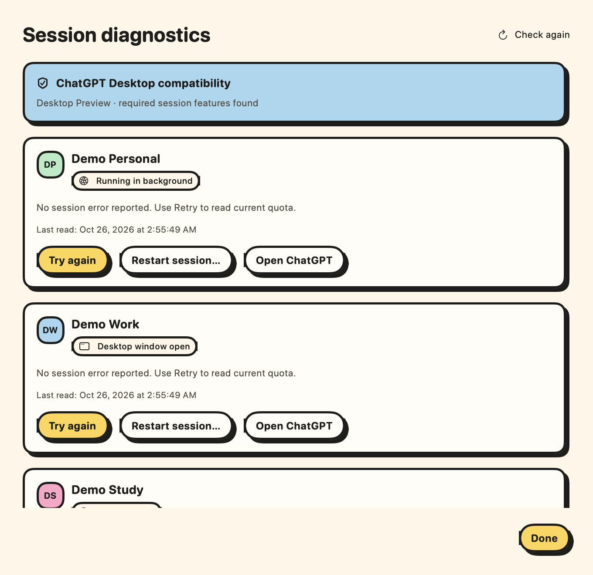

<p align="center"></p>

# AI Switcher for macOS

**Your AI accounts in one workspace. Separate browser profiles, ChatGPT Desktop sessions, and Codex quota.**

AI Switcher is a native SwiftUI and AppKit utility. Manage ChatGPT, Claude, Gemini, Antigravity, Perplexity, and DeepSeek from the dashboard or macOS menu bar. ChatGPT Desktop profiles retain separate sessions and Codex quota; other agents have the capabilities listed below.

**macOS 13+ · Intel and Apple Silicon · Swift · MIT license**

[](https://github.com/devoralabsapp/ai-switcher/actions/workflows/macos.yml)

[Download preview](https://github.com/devoralabsapp/ai-switcher/releases) · [Tiếng Việt](docs/README.vi.md) · [Architecture](docs/ARCHITECTURE.md) · [Contributing](CONTRIBUTING.md) · [Roadmap](docs/ROADMAP.md)


*English interface with the Code theme. Account labels and quota are fictional demo data.*

## What it does

- Launch the installed, official ChatGPT app with a separate sign-in and backend for each profile; optionally share local projects and Work history.
- Bring the exact existing profile process forward when switching.
- Show Codex quota remaining, hour/week windows, reset times, and the backend's account identity.
- Refresh quota manually or every five minutes while the profile backend is running.
- Name, color, favorite, search, and revisit profiles from a Vietnamese or English dashboard and menu bar.
- Close a profile without deleting its login, or explicitly delete its local data after closing.
- Open Claude, Gemini, Perplexity, and DeepSeek in separate Chrome/Edge/Brave browser profiles.
- Open the installed Antigravity app using its shared application sign-in.
- Filter agents from the sidebar, combined with search, favorites, and recents.
- Run without an API key, a hosted service, or third-party Swift packages.

This is an independent, **experimental** utility. Desktop profiles rely on internal launch settings in the new ChatGPT app with Chat, Work, and Codex (`com.openai.codex`). ChatGPT Classic is not supported. OpenAI does not document this as a supported multi-account interface; an app update can break compatibility. AI Switcher checks for the required mechanisms and reports an error if they are absent. It never silently falls back to Chrome.

## AI agents and sidebar filters

Choose **AI agent** when adding an account. The agent is fixed after creation to keep stored sign-ins associated with the same service. Existing profiles without an agent field remain ChatGPT profiles.

| Agent | Launch and sign-in | Quota and background connection |
| --- | --- | --- |
| ChatGPT | Separate Desktop session or browser profile | Codex quota; Desktop background connections |
| Claude, Gemini, Perplexity, DeepSeek | Separate Chromium browser profile for each account | Unavailable |
| Antigravity | Installed app; its existing shared sign-in | Unavailable |

Use **AI AGENTS** in the left sidebar to select an agent or **All agents**. Counts show saved entries, and the selected agent persists across relaunch. Favorites, recents, and search combine with the agent filter. Adding an account while filtered preselects that agent.

For browser agents, install Chrome, Edge, or Brave, add a profile, then sign in directly on the service's website. Each profile keeps its own browser storage. Antigravity supports one launcher entry: AI Switcher does not isolate or switch its accounts, close the shared app, or read its quota. Agent capabilities are reflected consistently in cards, the quota overview, menu bar, and diagnostics. Quota-only mode and notifications apply to ChatGPT/Codex.



## Install and use

Download a ZIP and `SHA256SUMS.txt` from [Releases](https://github.com/devoralabsapp/ai-switcher/releases), extract it, and move **AI Switcher.app** to Applications. Previews are signed ad hoc and are not notarized; source builds are also available.

For ChatGPT Desktop:

1. Install the new ChatGPT Desktop app at `/Applications/ChatGPT.app` or `~/Applications/ChatGPT.app`.
2. In AI Switcher, choose **Thêm tài khoản**, enter a name, and leave **ChatGPT Desktop** selected. The email field is an optional label.
3. Sign in to the intended account inside the new ChatGPT window. Verify its account menu. Normal authentication may open your system browser once; Chrome is not required for subsequent switching.
4. Repeat for the other accounts. The first launch of each profile can take longer while its backend is installed.
5. Use **Mở ChatGPT** or choose the profile from the menu bar to bring its window forward.

Existing profiles without an explicit mode now open in Desktop mode. They require one new sign-in; previous browser sessions and their separate quota connections are retained. To use them again, close the profile using **⋯ → Đóng phiên tài khoản…**, edit it, and choose **Trình duyệt**. Modes cannot change during an active session or quota operation.

Closing the manager keeps the menu bar available. Quitting AI Switcher leaves Desktop sessions running. **Đóng phiên tài khoản…** requests a normal quit of only that profile's applications and stops its backend; it does not force-quit. Service session expiry can still require a new sign-in.

| Shortcut (while AI Switcher is active) | Action |
| --- | --- |
| ⌘1–⌘9 | Open the corresponding profile |
| ⌘N / ⌘K / ⌘0 | Add / search / show manager |
| ⌘W / ⌘Q | Close manager / quit AI Switcher |
| ⌘, | Appearance and language |

## Language and appearance

Open **Appearance & Language** from the sidebar, the menu bar, or **⌘,**. Choose **English** or **Tiếng Việt** and one of six themes: **Light**, **Dark**, **Terminal**, **Code** (inspired by VS Code), **Dracula**, or **Playful Retro Neo-Brutalism**. Changes apply immediately and persist after relaunch. Existing users keep Vietnamese and Light until they choose otherwise.

Terminal and Code use monospace typography and compact corners. Playful Retro Neo-Brutalism adds warm cream surfaces, pastel yellow/pink/blue/mint cards, rounded system typography, 2.5-point ink outlines, and hard 4-point offset shadows. Its pill buttons and cards respond to presses and hovering, with animations respecting Reduce Motion. Themes cover the manager, account cards, dialogs, quota details, and native menu appearance. Language selection also updates menus, errors, quota labels, and date/number formatting. These preferences apply to AI Switcher.

<p align="center"></p>

<details>
<summary>Playful Retro Neo-Brutalism preview (fictional profiles and quota)</summary>



</details>

<details>
<summary>Terminal theme preview (fictional profiles and quota)</summary>



</details>

## Local projects and Work history

New Desktop profiles offer **Share local projects and Work history**. When selected, they use this Mac’s existing ChatGPT local project/history database, transcript folders, and Work artifact storage, while keeping their own authentication and browser storage. Cloud chats and cloud projects still belong to the signed-in account; this option does not transfer them between accounts.

For an existing profile, close its session fully from **⋯ → Close account session…**, edit the profile, enable sharing, then open it again. Existing profiles stay private until explicitly enabled. Profiles that already contain private local chats are preserved and cannot be switched automatically; create a new shared profile instead. Disable sharing only after closing the profile to restore its previous local workspace settings.

Local work is shared storage on this Mac. Continue a local chat in one Desktop window at a time. Deleting a shared profile keeps its shared transcripts and project/history database. Project/sidebar metadata is refreshed from the original workspace and other shared profiles on launch; existing windows may need reopening to pick up sidebar changes.

## Quota workspace and session states

Enable **Quota-only mode** on the dashboard or in **Appearance & Language**. Default clicks on Desktop account cards, avatars, quick access, and menu-bar accounts then connect in the background instead of opening Desktop. Explicit **Open ChatGPT Desktop** remains in the account menu. Browser profiles retain their existing action. Existing users keep their previous behavior until they opt in.

In **Edit profile**, choose **Default account action** separately for each Desktop profile and optionally enable **Connect in background when AI Switcher starts**. Startup connection is off by default, runs only for selected Desktop profiles, and never opens a window or starts a sign-in flow. Global quota-only mode overrides the per-profile action while enabled; turning it off restores each profile's choice and the workspace layout used before enabling it, including across app relaunch. Older saved quota-only sessions without a previous-layout record return to account cards. Background connections do not change recently opened accounts.

The dashboard keeps **Quota-only mode** beside **Add account**. Choose **Workspace view → Account cards / Quota overview** in **Appearance & Language** to change the layout. The table shows remaining quota in the primary/secondary windows, actual window durations, next future reset, last update, and session status. Click column headings to toggle sorting; quota sorting puts missing, expired, failed, or stale values last. Each row uses the first limit group (preferring `codex`); **Details** shows all groups without combining their percentages. View and sort choices persist after relaunch. Small windows support horizontal table scrolling.

Session badges distinguish **Disconnected**, **Connecting**, **Opening**, **Closing**, **Running in background**, **Desktop window open**, **Browser running**, **Sign-in required**, and **Connection failed**. Desktop window status includes minimized windows and uses the existing local window metadata check. Reading quota refreshes session state immediately; normal monitoring checks it every three seconds. Old quota snapshots stay visibly marked when stale or a refresh fails.

<details>
<summary>Quota overview preview (fictional accounts and quota)</summary>



</details>

## Menu bar, notifications, and session recovery

Each account in the menu bar opens a submenu with its session state, every quota group/window, reset times, last read, and targeted actions. Connect or refresh quota, open the exact Desktop profile, close its session with confirmation, or inspect Details without navigating the account dashboard. The default action is labeled separately. Missing/expired quota remains unknown, and cached results are labeled when stale.

In **Appearance & Language → Quota notifications**, enable alerts and approve macOS notification permission. Alerts are off by default. Set a remaining-quota threshold from 1–95% and optionally enable recovery alerts. A successful fresh read at or below the threshold sends one low-quota alert per window transition; repeated low readings do not repeat it. Recovery requires a new successful read above the threshold after a low observation. Reset timestamps do not schedule or invent recovery. Alerts cover Desktop and connected browser-mode quota, run only while AI Switcher is open, and are silent. Threshold observations persist across relaunch to prevent duplicates; disabling alerts resets their baseline. Click a notification to inspect that account's quota. If macOS blocks notifications, the permission status explains where to enable them.

Open **Session diagnostics** from the sidebar or menu bar to inspect the installed Desktop version and required isolation mechanisms, profile ownership checks, current session state, and latest quota result/check time. **Try again** reads quota or connects the stopped Desktop backend; browser profiles without a quota connection open their connection details. **Restart session…** asks you to save drafts, stops only the selected profile normally, and reconnects its backend in the background. Sign-in and local data are kept, no Desktop window is reopened, and a refused close does not start another backend. Storage verification failures disable reconnect/restart controls; restarting is never a substitute for signing in again.

<details>
<summary>Session diagnostics preview (fictional accounts)</summary>



</details>

## Codex quota

For Desktop profiles, sign in inside that Desktop window; quota appears automatically within a few seconds. AI Switcher retries while waiting for sign-in and backs off on read errors; **Làm mới quota** is also available for a manual refresh. The reader first checks that profile’s local daemon through a WebSocket bridge. Some Desktop configurations use a separate stdio backend, leaving the daemon signed out after a successful Desktop login. In that case the bundled Codex CLI reads the saved session from the **same profile home**. AI Switcher never starts a second quota login or imports your default Codex session. The returned email/plan identifies the quota account; profile names remain user-entered labels. Sign out within the relevant ChatGPT window when changing its account.

Use **⋯ → Connect account session** to start only the profile backend and read quota without opening or activating ChatGPT Desktop. The **Connect** action on an inactive quota card and a manual quota refresh also connect in the background. Saved sign-in is reused; new or signed-out profiles need one explicit **Open ChatGPT** sign-in first. **Close account session…** stops the backend again and keeps the saved login. Background connection does not change your recent/opened profiles.

Cards and the menu bar show **remaining** quota in the windows returned by Codex, such as five hours and a week. Details include all separate limit buckets and reset timestamps. Missing windows remain unknown. Snapshots are marked stale after six minutes, reset expiry, or a failed refresh; a reset timestamp never invents a refill. Closing the profile stops live refresh and leaves the last cached snapshot.

Browser-mode profiles retain the optional **Kết nối → Đăng nhập Codex → Dùng tài khoản này** flow. Their Codex login is separate from browser ChatGPT login and requires identity confirmation. **Ngắt kết nối** removes only that browser profile's separate Codex home.

Quota uses [`account/read` and `account/rateLimits/read`](https://learn.chatgpt.com/docs/app-server). The reader performs no model turns and redeems no reset credits.

## Privacy and storage

AI Switcher does not read passwords, cookies, token files, or conversations. ChatGPT and Codex manage their own authentication and usual network requests. AI Switcher reads identity and quota protocol responses and caches them in `accounts.json`. Child environments exclude inherited API keys and authentication/CLI overrides.

```text
~/Library/Application Support/AI Switcher/
├── accounts.json                  # Labels, selected mode, identities and cached quota
├── Desktop/<UUID>/UserData/        # ChatGPT Desktop UI and browser storage
├── Desktop/<UUID>/backend-location.txt
├── SharedWorkspaceMetadata/       # Local sidebar metadata retained for shared history
├── Profiles/<UUID>/               # Browser profiles for ChatGPT and other web agents
└── Codex/<UUID>/                  # Optional browser-mode quota login

~/.aisw/<profile-key>/             # Desktop backend, configuration and authentication
└── ai-switcher-profile.json       # Ownership marker: app-data root and profile UUID
```

The short `~/.aisw` location keeps Unix socket paths within macOS limits. Its stable key hashes the app-data root and profile UUID, so development and production profiles do not share a backend. An ownership marker must match before the app reuses or removes a backend. Authentication is never imported from your default ChatGPT or `~/.codex` session. With local workspace sharing enabled, AI Switcher carries over selected project/sidebar metadata, uses `CODEX_SQLITE_HOME` for the shared database, and links the local transcript directories. Other UI state, browser storage and authentication remain private. Desktop backends use file-based credentials managed by Codex.

New app directories use `0700`, and metadata uses `0600`. These are private sessions belonging to the current macOS user, **not an encrypted vault** or protection from other software running as that user. Do not upload profile data to GitHub. Exact process arguments identify the profile before focus or termination; the app never quits every process named ChatGPT.

Close a profile before deletion. Deletion stages its Desktop, backend, browser and optional Codex directories, saves metadata, then removes them; metadata-save failure restores staged data. It does not delete service accounts or server-side conversations. OS-level deep links, notifications, permissions, and other bundle-ID integrations may be shared between instances; check the intended window when using them. See [SECURITY.md](SECURITY.md).

## Build and verify

Use macOS 13+, Xcode/Command Line Tools with Swift 5.9+, and Python 3 for icon packaging. Desktop runtime additionally needs the compatible ChatGPT app; browser mode needs Chrome, Edge, or Brave.

```sh
bash scripts/test.sh
bash scripts/build.sh --universal
bash scripts/package.sh
```

Output: `dist/AI Switcher.app`, `dist/AI-Switcher-macOS.zip`, and `dist/SHA256SUMS.txt`. Omit `--universal` for a local-architecture build. GitHub Actions runs offline tests and builds/packages both architectures.

Local integration checks require a graphical macOS login session:

```sh
bash scripts/test.sh --desktop  # Two disposable real ChatGPT instances and local backend connections
bash scripts/test.sh --browser  # Chrome windows plus loopback cookie/localStorage fixture
bash scripts/test.sh --codex    # Installed CLI handshake in a fresh unauthenticated home
```

The core/protocol, Desktop discovery and shared-workspace suite has 105 tests covering storage, ownership, migration, exact routing, deletion/rollback, quota semantics, JSONL lifecycle, preference persistence, translation coverage/format placeholders, theme text contrast, agent migration/filter persistence, provider routing, and capability guards. Desktop smoke checks verify distinct processes, empty identities through each shared backend, window reuse, close/reopen persistence, and cleanup without closing existing ChatGPT instances. The optional `bash scripts/test.sh --session` smoke check verifies a real isolated backend starts, restarts, and stops without launching a ChatGPT Desktop process. Notification decisions, permission handling, quick-menu wiring, and recovery failure guards use fixtures; actual notification banners depend on macOS permission and notification settings. No real accounts or model requests are used in automated checks.

**Early preview:** local checks run on Intel with ChatGPT Desktop 26.1021.31345. Universal compilation does not establish Apple Silicon runtime coverage. Real sign-in, live quotas, minimized windows, multiple Spaces, and OS deep-link routing still require manual field testing. Edge/Brave have less integration coverage than Chrome. The interface supports Vietnamese and English.

Use a separate development profile root:

```sh
"dist/AI Switcher.app/Contents/MacOS/AISwitcher" --data-dir /tmp/ai-switcher-dev
```

## Contribute

Compatibility reports, accessibility improvements, and localization contributions are welcome. See [CONTRIBUTING.md](CONTRIBUTING.md). The initial implementation was developed with OpenAI Codex assistance; contributors are responsible for checking changes and reporting actual validation.

Released under the [MIT License](LICENSE). The icon is original geometric drawing code in this repository. Legacy browser isolation follows Chromium's [`--user-data-dir` mechanism](https://chromium.googlesource.com/chromium/src/+/main/docs/user_data_dir.md). AI Switcher is not affiliated with or endorsed by OpenAI or browser vendors.
