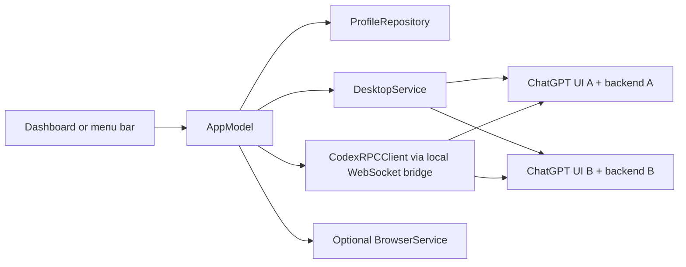

# Architecture

A SwiftUI/AppKit macOS manager with an independently testable Swift core. No hosted backend or third-party Swift packages are included. ChatGPT Desktop runs its own local backend per profile.

## Profile identity and storage

Each account UUID selects stable storage independent of its editable labels. Versioned JSON retains optional launch mode, separate Desktop/browser quota connections, and recent-use metadata. Old snapshots decode without new fields; an absent mode now selects Desktop. Browser sessions are retained, never converted by copying authentication.

UI data stays at `Desktop/<UUID>/UserData` under the app-data root. Backend homes use `~/.aisw/<key>`, where the key is the first 128 bits of SHA-256 of the normalized app root and UUID, encoded as base64url. This keeps the backend Unix socket path under macOS's 104-byte limit, including when the app-data root is long. A marker records the original root and UUID; existing backend directories require a matching marker. Owned directories reject symlinks and wrong OS ownership. The UI profile records the backend location for recovery.

Deleting a stopped profile stages its four data directories beside their respective original locations, saves metadata, then deletes staged data. A failed save restores all staged directories. Cleanup errors surface and trigger metadata reload. Moving each directory within its own parent avoids cross-volume renames between app data and backend storage.

## Desktop lifecycle

`DesktopService` locates ChatGPT with bundle ID `com.openai.codex`, checks the installed app archive for required launch mechanisms, and uses its bundled CLI. This targets the new ChatGPT with Chat, Work, and Codex; it does not support ChatGPT Classic. These mechanisms are internal and experimental, not a vendor-supported multi-account API.

The service starts a profile-owned `codex app-server daemon` with an explicit `CODEX_HOME`, file-based credentials, and analytics disabled. The first start installs the bundled daemon locally; it does not bootstrap a system service. The Desktop process receives:

- `CODEX_HOME`: the matching backend directory.
- `CODEX_ELECTRON_USER_DATA_PATH`: the matching UI directory.
- `CODEX_APP_SERVER_USE_LOCAL_DAEMON=1`: connect to that profile's daemon.
- `--user-data-dir=<exact UI directory>`: separate Electron storage and instance lock.

Arguments go directly to `Process`, with no shell. The environment is allowlisted; inherited authentication keys, forced CLI overrides and other profile settings are dropped. Default ChatGPT and Codex directories are never imported or rewritten.

`ManagedApplications` matches a full data-directory argument on the correct bundle ID, excluding renderer/helper processes. CoreGraphics provides window metadata, not screenshots. Existing windows activate by exact process; launching the same profile again forwards a reopen request through its Electron instance lock if all windows were closed. Closing requests normal termination of only that matched UI process, waits for exit, then stops its exact backend. It never force-quits or kills applications by name.

Profile windows/backends persist after AI Switcher quits. Local daemons allow quota reads without starting a second independent backend that could race authentication refresh. macOS integrations keyed by bundle ID (deep links, permissions, notifications) can still be shared; they are outside the profile routing guarantee.

## Quota

`CodexRPCClient` is an actor with JSONL stdio, fragmented-message support, deadlines, cancellation, early login notifications, and EOF handling. It exposes initialization and account operations, never model threads or reset credits. Raw server errors become fixed messages.

Desktop reads use a child copy of AI Switcher in `--quota-socket-bridge` mode against the same backend as its UI. It upgrades a local Unix connection at `/rpc` to WebSocket, validates the handshake, masks client frames, handles fragmentation/ping/close, and relays JSONL to the restricted reader. It opens no TCP listener. Socket ownership is checked after resolving the daemon's socket symlink. Identity is read before and after quota; an identity change invalidates the read. Signed-out profiles clear their cached Desktop connection. The helper stops after each operation; stopping a bridge does not stop the Desktop daemon. Desktop sign-out belongs to the ChatGPT window, so the manager offers no separate quota logout for Desktop.

Optional browser quota still uses `CodexQuotaService` and `Codex/<UUID>` with explicit identity confirmation and account-ID checks. Validated HTTPS login URLs open only in the corresponding browser profile. Browser and Desktop cache fields remain separate when changing mode.

Polling is sequential every five minutes while a Desktop backend exists, or while a browser quota connection is saved. `100 - usedPercent` is clamped to 0–100. Multiple buckets remain separate; nonempty multi-bucket responses take precedence. Missing windows are unknown, and expired reset times never fabricate refill. Last-read timestamps and stale/error states remain visible.

Protocol reference: [Codex App Server](https://learn.chatgpt.com/docs/app-server).

## Browser fallback and verification

`BrowserService` retains Chrome/Edge/Brave app-window launching with UUID-specific `--user-data-dir`, exact argument matching and normal termination. It runs only when the profile explicitly selects browser mode.

The offline core/protocol suite verifies persistence, migration, owner markers, environment isolation, routing, permissions, staged deletion/rollback, quota semantics and JSONL lifecycle. `--desktop` uses two new real Desktop profiles, verifies separate PIDs, blank identities through each daemon, reuse, close/reopen persistence and cleanup while existing instances remain alive. `--browser` adds Chrome GUI checks and a headless loopback cookie/localStorage fixture; `--codex` probes an empty standalone CLI home.

CI runs offline tests and universal compilation/packaging. Real account authentication, live quota, Apple Silicon runtime behavior, minimized windows and multiple Spaces require manual coverage. The interface supports Vietnamese and English.

## Language and appearance

`AppPreferencesStore` stores language/theme identifiers in the app's UserDefaults domain, separately from account metadata and authentication. Unknown preferences fall back independently to Vietnamese/Light, preserving the behavior of earlier releases. SwiftUI observes the preferences through `AppModel`; views inherit the selected theme and locale. AppKit rebuilds native menus and updates the manager window appearance when preferences change.

`L10n` uses English source keys with matching `en.lproj` and `vi.lproj` resources. All interpolated arguments use string placeholders, with catalog parity and source-key coverage tests. Quota formatting uses the selected locale and supports singular English window units. Stored quota errors retain their error value so their description follows the selected language.

Five palettes define foreground, secondary, accent, button foreground, borders, and surfaces. Terminal and Code also use monospace fonts and compact corners. Contrast tests check body/secondary text against every surface and primary button text against its accent. `AppearancePreview` renders app-owned offscreen views with fictional data; it captures no screen pixels or real profiles.

The build copies the SwiftPM localization resource bundle into the app's Resources directory before signing. Packaging runs `--localization-smoke-test`, which verifies both languages load from inside the distributable app rather than a developer build-cache path.
