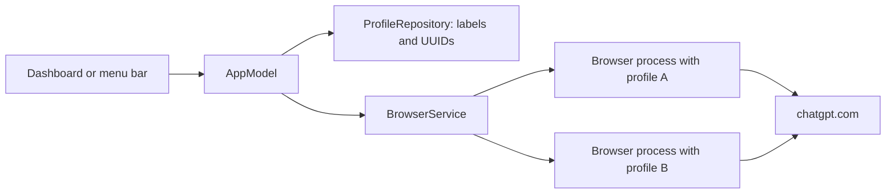

# Architecture

AI Switcher is a native macOS executable with a small, independently testable core. It has no server component or third-party Swift package dependency.

## Data flow

Authentication happens between the browser and the service. No authentication response is routed through AI Switcher.

## Core

`AISwitcherCore` defines accounts, colors, supported browser identifiers, snapshot validation, and browser launch arguments. An account's UUID is its stable storage identity. Labels are editable; renaming an account cannot select a different directory.

`ProfileRepository` reads and atomically writes versioned JSON metadata. It rejects corrupt data, duplicate IDs, unsupported versions, and invalid selections. A failed load is surfaced instead of replacing the file with an empty list.

Each account's browser data directory is derived from its UUID. For deletion, the repository stages the directory, saves updated metadata, then removes the staged data. If saving metadata fails, it attempts to restore the directory. A cleanup failure is surfaced; the caller reloads saved metadata so the interface reflects the durable result.

## Native application

`AppModel` coordinates editing, filtering, opening, closing, and deletion. `AppDelegate` owns the AppKit window and menu bar; the dashboard and dialogs use SwiftUI.

`BrowserService` locates an installed browser by bundle identifier. It starts the browser executable with a dedicated `--user-data-dir` and ChatGPT in app-window mode. Arguments are passed directly to `Process`, without a shell.

To reuse a session, the service enumerates running applications with the matching browser bundle ID, reads their process argument vectors, and matches the complete profile argument. Helpers with a `--type=` argument do not qualify as the main browser process. CoreGraphics supplies window metadata to decide whether there is a window to activate; the app does not capture screen pixels.

Closing a session requests termination only of the matched dedicated browser process and waits for it to exit. It does not force-kill a process. Deletion is refused while the matching profile is running.

## Tests and limits

The core unit suite verifies persistence, validation, storage separation, exact argument matching, permissions, targeted deletion, and deletion rollback.

Local GUI smoke checks create two throwaway profiles, verify distinct browser processes, switch back to a process without creating another window, then terminate only those test sessions. A separate headless loopback fixture verifies isolated and persistent cookies and localStorage.

CI runs unit tests and a universal app build. Manual ChatGPT authentication, minimized-window behavior across macOS versions, and vendor-managed browser policies need further field testing. The current interface supports Vietnamese; internationalization is planned.
