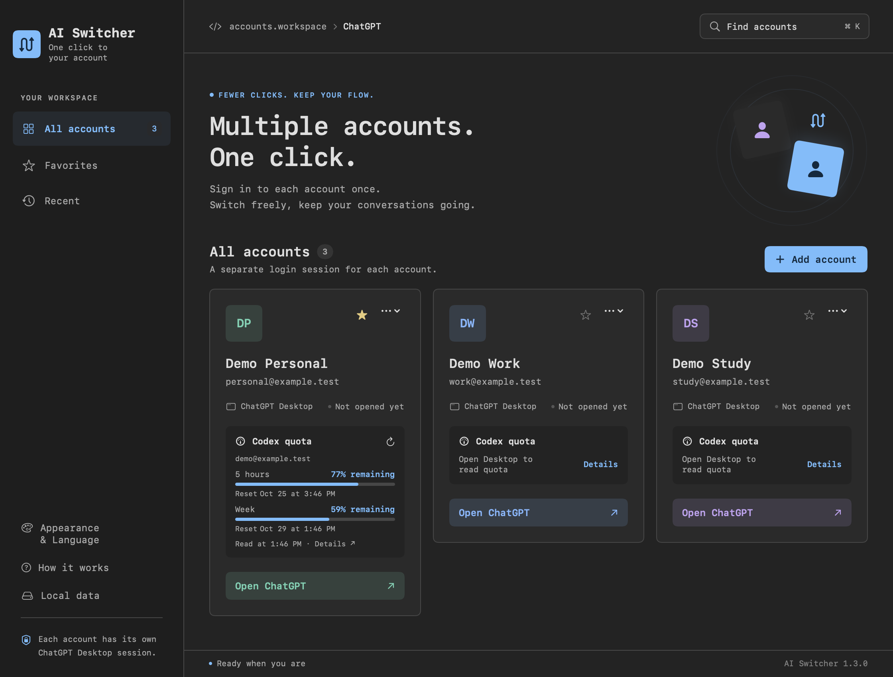
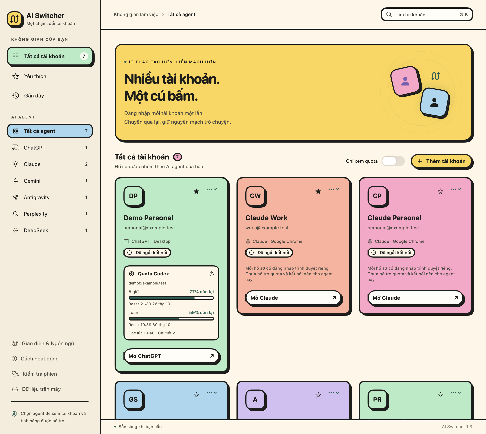
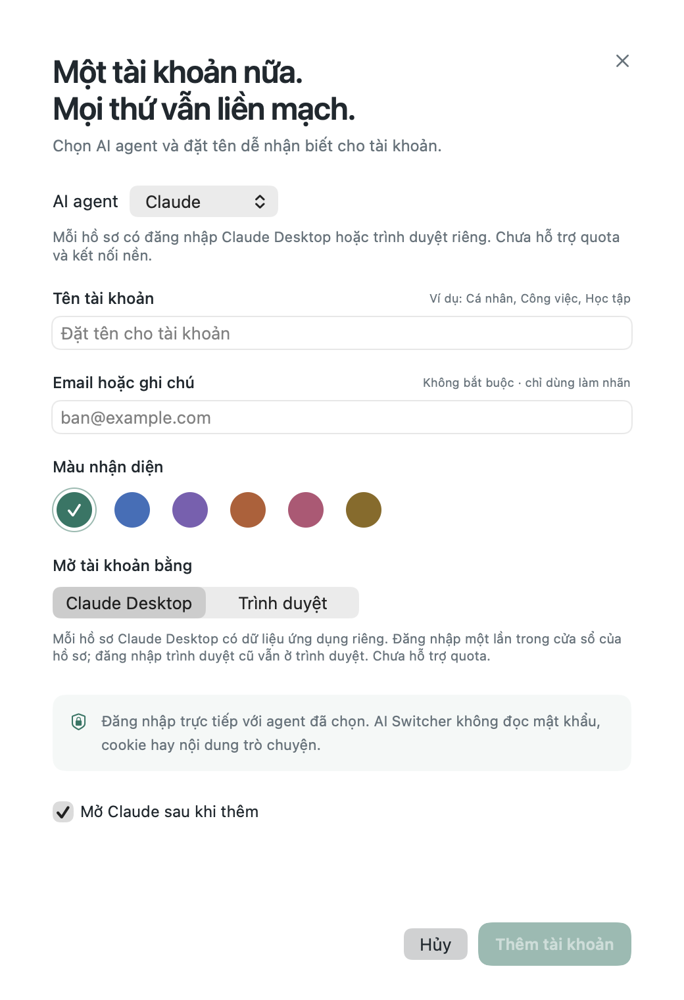
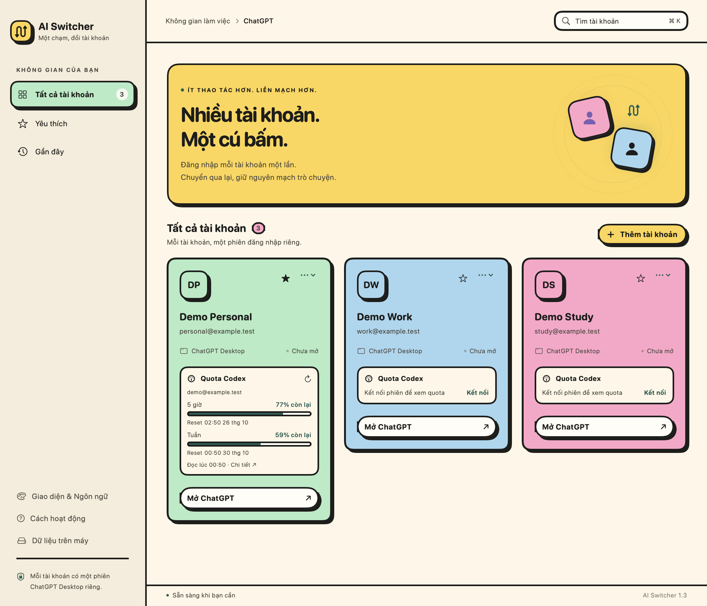
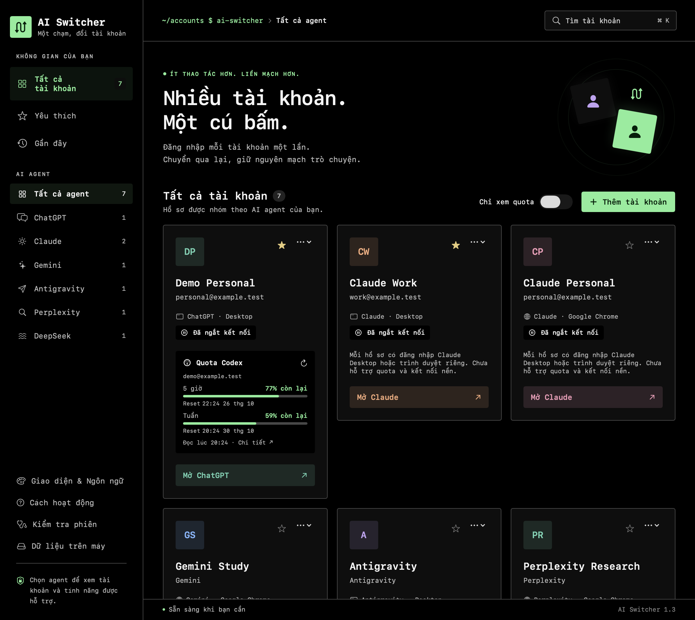
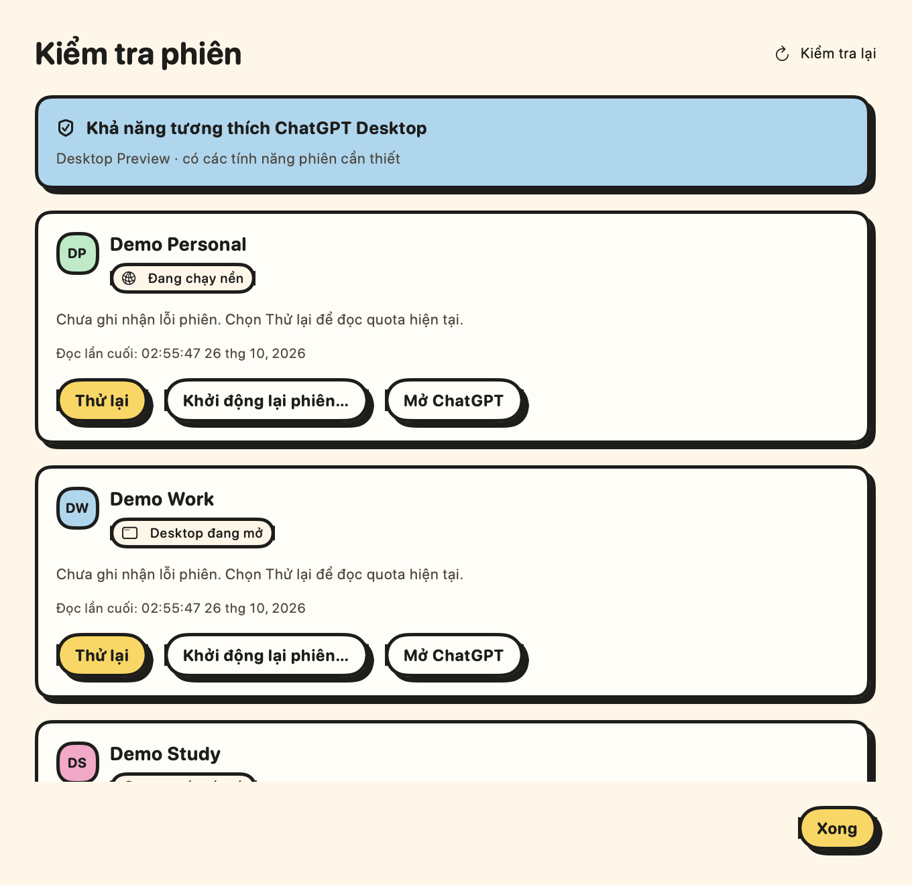
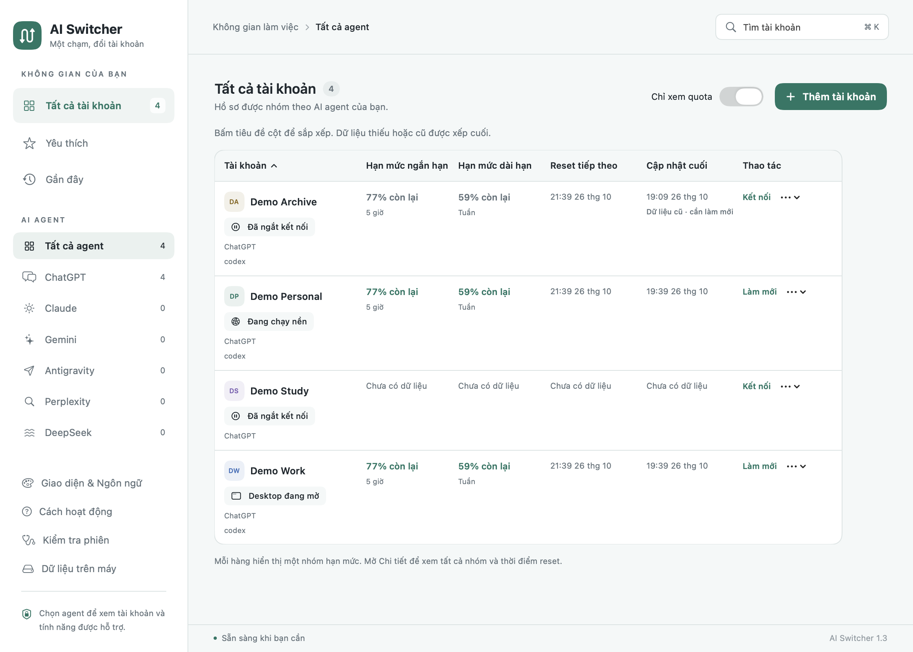

# AI Switcher cho macOS và Windows

Bản Windows preview dùng .NET/WPF, có gói x64 và ARM64. Xem [hướng dẫn Windows](../Windows/README.md) và [bản build Windows](https://github.com/devoralabsapp/ai-switcher/actions/workflows/windows.yml). Phần dưới mô tả bản macOS.

[English README](../README.md) · [Tải bản dùng thử](https://github.com/devoralabsapp/ai-switcher/releases)

Quản lý **ChatGPT, Claude, Gemini, Antigravity, Perplexity và DeepSeek** trong một app SwiftUI có giao diện tiếng Việt/tiếng Anh và thanh menu macOS. ChatGPT giữ các phiên Desktop riêng cùng quota Codex; các agent khác dùng khả năng được mô tả bên dưới.



*Giao diện tiếng Anh, theme Code. Tên tài khoản và quota trong ảnh là dữ liệu mẫu.*

## AI agent và bộ lọc bên trái

Khi thêm tài khoản, chọn **AI agent** rồi đặt tên hồ sơ. Agent không đổi được sau khi lưu để giữ đăng nhập đúng dịch vụ; hồ sơ cũ tiếp tục là ChatGPT.

| Agent | Cách mở và đăng nhập | Quota và kết nối nền |
| --- | --- | --- |
| ChatGPT | Phiên Desktop riêng hoặc hồ sơ trình duyệt riêng | Quota Codex; kết nối nền cho Desktop |
| Claude | Hồ sơ Desktop hoặc Chrome/Edge/Brave riêng cho từng tài khoản | Chưa hỗ trợ |
| Gemini, Perplexity, DeepSeek | Hồ sơ Chrome/Edge/Brave riêng cho từng tài khoản | Chưa hỗ trợ |
| Antigravity | Mở ứng dụng đã cài, dùng đăng nhập chung của ứng dụng | Chưa hỗ trợ |

Chọn agent hoặc **Tất cả agent** ở thanh điều hướng bên trái. Bộ lọc kết hợp với tìm kiếm, Yêu thích và Gần đây; số đếm thể hiện tổng hồ sơ đã lưu của từng agent. App nhớ bộ lọc khi mở lại và tự chọn agent đó khi thêm hồ sơ.

Với agent trình duyệt, cài Chrome, Edge hoặc Brave rồi đăng nhập trực tiếp trong cửa sổ của hồ sơ. Antigravity chỉ có một mục mở ứng dụng: app không tách/chuyển tài khoản, đóng ứng dụng dùng chung hoặc đọc quota của Antigravity. Thẻ tài khoản, bảng quota, menu bar và kiểm tra phiên hiển thị đúng khả năng từng agent. Chỉ xem quota, kết nối nền và thông báo quota áp dụng cho ChatGPT/Codex.



## Claude Desktop riêng cho từng tài khoản

Cài Claude chính thức vào Applications. Khi thêm hồ sơ Claude, chọn **Claude Desktop** rồi đăng nhập trực tiếp trong cửa sổ riêng của hồ sơ. Mở lại hồ sơ sẽ đưa đúng cửa sổ lên trước; **Đóng phiên tài khoản…** chỉ đóng hồ sơ đó và giữ dữ liệu.

Với hồ sơ Claude đã tạo bằng trình duyệt: đóng phiên, chọn **Sửa hồ sơ → Claude Desktop**, rồi đăng nhập một lần trong cửa sổ Desktop mới. Đăng nhập trình duyệt cũ vẫn được giữ khi đổi lại Browser. Mỗi hồ sơ Desktop dùng thư mục dữ liệu riêng, không sao chép đăng nhập Claude mặc định. Chưa hỗ trợ quota, kết nối nền hoặc chia sẻ lịch sử Work cho Claude.

Đã kiểm tra Claude 3.6556.2 với hai tiến trình/cửa sổ mới, dùng lại đúng cửa sổ, đóng/mở riêng và giữ dữ liệu từng hồ sơ. Đăng nhập hai tài khoản thật, OAuth/deep link, Claude Code và Cowork vẫn cần kiểm tra thủ công. Chế độ này thử nghiệm và có thể bị ảnh hưởng khi Claude cập nhật.

<details>
<summary>Thêm hồ sơ Claude Desktop với dữ liệu mẫu</summary>



</details>

## Cách dùng ChatGPT Desktop

1. Cài ChatGPT Desktop mới có Chat, Work và Codex vào Applications. **ChatGPT Classic chưa được hỗ trợ.**
2. Tải ZIP từ Releases, giải nén và kéo **AI Switcher.app** vào Applications. Bản preview ký ad hoc, chưa notarize.
3. Bấm **Thêm tài khoản**, đặt tên/màu, giữ chế độ **ChatGPT Desktop**. Email chỉ là nhãn tùy chọn.
4. Đăng nhập đúng tài khoản trong cửa sổ ChatGPT vừa mở. Lần đầu có thể chờ lâu hơn để cài backend riêng; xác thực có thể mở trình duyệt mặc định một lần.
5. Lặp lại cho tài khoản khác. Sau đó bấm **Mở ChatGPT** trên thẻ hoặc chọn hồ sơ từ thanh menu để đưa đúng cửa sổ lên trước.
6. Đăng nhập xong, quota tự hiện sau vài giây từ phiên của đúng hồ sơ Desktop, không cần đăng nhập Codex lần thứ hai. Nếu daemon còn giữ trạng thái chưa đăng nhập, Codex đọc phiên đã lưu trong chính thư mục hồ sơ đó qua giao thức app-server. App tự thử lại khi đang chờ đăng nhập hoặc gặp lỗi đọc; bạn cũng có thể bấm **Làm mới quota**.

Đây là chế độ **thử nghiệm**, dựa trên cơ chế khởi động nội bộ của ChatGPT mới (`com.openai.codex`). OpenAI chưa công bố đây là giao diện chuyển nhiều tài khoản được hỗ trợ; bản cập nhật ChatGPT có thể làm cơ chế này thay đổi. App báo lỗi khi thiếu cơ chế tách phiên, không tự mở Chrome thay thế.

Hồ sơ cũ mặc định chuyển sang Desktop và cần đăng nhập mới một lần. Phiên trình duyệt và kết nối quota cũ vẫn được giữ. Muốn quay lại, chọn **⋯ → Đóng phiên tài khoản…**, sửa hồ sơ và chọn **Trình duyệt**. Không đổi chế độ khi phiên hoặc thao tác quota đang chạy.

## Ngôn ngữ và theme

Mở **Giao diện & Ngôn ngữ** ở thanh bên, menu macOS hoặc bấm **⌘,**. Chọn **Tiếng Việt / English** và theme **Sáng, Tối, Terminal, Code (lấy cảm hứng từ VS Code), Dracula, Playful Retro Neo-Brutalism, Terminal Black**. Lựa chọn áp dụng ngay và được giữ khi mở lại app.

Terminal, Terminal Black và Code dùng font đơn cách, góc gọn cùng bảng màu riêng. Terminal Black có nền đen thuần, thẻ gần đen, chữ sáng và điểm nhấn xanh; theme Terminal cũ vẫn được giữ. Playful Retro Neo-Brutalism dùng nền kem, thẻ màu pastel, chữ bo tròn, viền đậm và bóng đổ cứng, cùng hiệu ứng nút bấm có hỗ trợ Giảm chuyển động. Theme áp dụng cho giao diện AI Switcher, hộp thoại và quota. Bản dịch bao gồm menu, thông báo lỗi, hạn mức, số và ngày giờ. Tài khoản và phiên đăng nhập vẫn dùng dữ liệu hiện có.

<details>
<summary>Xem theme Playful Retro Neo-Brutalism với dữ liệu mẫu</summary>



</details>

<details>
<summary>Theme Terminal Black với dữ liệu mẫu</summary>



</details>

Xem [ảnh mẫu các theme](../README.md#language-and-appearance); ảnh dùng hồ sơ và quota giả để minh họa.

## Menu bar, thông báo quota và khôi phục phiên

Mở tài khoản trong menu bar để xem trạng thái, mọi nhóm quota, thời điểm reset và lần đọc cuối. Menu riêng có nút kết nối/làm mới, mở đúng cửa sổ Desktop, đóng phiên có xác nhận và xem chi tiết. Kết nối hoặc đóng phiên không cần mở dashboard.

Trong **Giao diện & Ngôn ngữ → Thông báo quota**, bật thông báo và cho phép trong hộp thoại macOS. Mặc định thông báo tắt. Chọn ngưỡng quota còn lại từ 1–95%, cùng tùy chọn báo quota hồi. Chỉ dữ liệu mới đọc thành công mới tạo thông báo: báo thấp một lần khi chạm/xuống ngưỡng, và chỉ báo hồi khi đọc được quota vượt ngưỡng sau đó. Đến giờ reset không tự tạo thông báo. App lưu trạng thái ngưỡng để tránh lặp sau khi mở lại; tắt thông báo sẽ xóa mốc theo dõi. AI Switcher cần đang chạy, thông báo không phát âm thanh. Bấm thông báo để xem quota của đúng tài khoản. Nếu bị chặn, phần trạng thái quyền hướng dẫn bạn bật lại trong cài đặt macOS.

Chọn **Kiểm tra phiên** ở thanh bên hoặc menu bar để xem phiên bản Desktop và tính năng cần thiết, kiểm tra dữ liệu hồ sơ, trạng thái và kết quả quota gần nhất. **Thử lại** đọc quota hoặc kết nối phiên nền đã dừng. **Khởi động lại phiên…** có xác nhận trước khi đóng cửa sổ, chỉ dừng đúng hồ sơ rồi kết nối lại trong nền, giữ đăng nhập và dữ liệu, không tự mở Desktop. Nếu phiên từ chối đóng, app không khởi chạy chồng thêm backend. Dữ liệu hồ sơ không xác minh được sẽ tắt nút kết nối/khởi động lại; tài khoản hết phiên vẫn cần đăng nhập lại rõ ràng.

<details>
<summary>Xem trang kiểm tra phiên với dữ liệu mẫu</summary>



</details>

## Chỉ xem quota và trạng thái phiên

Bật **Chỉ xem quota** ở dashboard hoặc **Giao diện & Ngôn ngữ** để các thao tác mặc định trên hồ sơ Desktop kết nối nền. Muốn mở cửa sổ, chọn **⋯ → Mở ChatGPT Desktop**. Hồ sơ trình duyệt vẫn hoạt động như trước.

Trong **Sửa hồ sơ**, chọn **Thao tác mặc định** cho từng hồ sơ và bật **Kết nối nền khi mở AI Switcher** nếu muốn. Tự kết nối mặc định tắt, chỉ áp dụng cho hồ sơ Desktop được chọn và không mở cửa sổ hay tự đăng nhập. Khi bật Chỉ xem quota, app ưu tiên Kết nối nền; khi tắt, lựa chọn thao tác riêng của hồ sơ được dùng lại và app luôn trở về Thẻ tài khoản. Khi nâng cấp, phiên cũ đã tắt chế độ này nhưng còn kẹt ở bảng quota được tự sửa một lần.

Nút **Chỉ xem quota** nằm bên trái **Thêm tài khoản** trên dashboard. Đổi kiểu hiển thị ở **Giao diện & Ngôn ngữ → Kiểu hiển thị → Thẻ tài khoản / Tổng quan quota**. Chọn **Tổng quan quota** để xem hạn mức ngắn/dài hạn, thời lượng thực tế, reset tiếp theo, lần cập nhật cuối và trạng thái. Bấm tiêu đề cột để đổi thứ tự; quota thiếu, cũ, lỗi hoặc đã qua reset được xếp cuối khi sắp xếp hạn mức. Mỗi hàng hiển thị một nhóm hạn mức, ưu tiên `codex`; mở **Chi tiết** để xem mọi nhóm. Cửa sổ nhỏ có thể cuộn bảng ngang. Kiểu hiển thị và cách sắp xếp được lưu cho lần mở sau.

Nhãn trạng thái phân biệt **Đã ngắt kết nối**, **Đang chạy nền**, **Desktop đang mở**, **Cần đăng nhập lại**, **Kết nối thất bại** và các thao tác đang xử lý. Kết nối nền không thay đổi danh sách tài khoản đã mở gần đây.

<details>
<summary>Xem bảng tổng quan quota với dữ liệu mẫu</summary>



</details>

## Project và lịch sử Work local

Khi thêm hồ sơ Desktop, bật **Chia sẻ project và lịch sử Work trên máy** để thấy các project và chat/Work local đang có trong ChatGPT gốc. Các hồ sơ vẫn giữ đăng nhập và dữ liệu trình duyệt riêng. Chat và project cloud vẫn thuộc tài khoản đang đăng nhập; đây không phải tính năng chuyển dữ liệu cloud giữa tài khoản.

Với hồ sơ cũ, chọn **⋯ → Đóng phiên tài khoản…**, sửa hồ sơ, bật chia sẻ rồi mở lại. Hồ sơ đã có lịch sử riêng sẽ được giữ nguyên và không tự ghép; hãy tạo hồ sơ chia sẻ mới trong trường hợp đó. Tắt chia sẻ khi phiên đã đóng để khôi phục cấu hình local riêng trước đây.

Dữ liệu công việc và các artifact của Work được dùng chung trên máy Mac này. Hãy tiếp tục một chat local trong một cửa sổ Desktop tại một thời điểm. Xóa hồ sơ không xóa lịch sử/project chung. Danh sách và bố cục sidebar được cập nhật khi mở phiên; cửa sổ đang mở có thể cần đóng/mở lại để nhận thay đổi.

## Quota và đóng phiên

Thẻ hiển thị phần trăm **còn lại** và thời điểm reset của các cửa sổ do Codex trả về, thường là giờ/tuần. Bấm chi tiết để xem mọi nhóm hạn mức, email/gói và lần đọc gần nhất. Email trong mục quota do backend trả về, khác với nhãn bạn tự đặt.

Chọn **⋯ → Kết nối phiên tài khoản** để chỉ chạy phiên nền và đọc quota, không mở hoặc kích hoạt cửa sổ ChatGPT Desktop. Nút **Kết nối** trên thẻ quota chưa hoạt động và thao tác làm mới quota cũng kết nối trong nền. App sử dụng lại đăng nhập đã lưu; hồ sơ mới hoặc đã đăng xuất cần bấm **Mở ChatGPT** để đăng nhập một lần trước. **Đóng phiên tài khoản…** dừng phiên nền và vẫn giữ đăng nhập. Kết nối nền không thay đổi danh sách hồ sơ mở gần đây. Nút Kết nối phiên tài khoản bị vô hiệu hóa khi phiên đó đang chạy; Làm mới quota vẫn dùng được.

Quota tự cập nhật mỗi 5 phút khi backend của hồ sơ đang chạy. Không có dữ liệu thì hiển thị chưa biết; dữ liệu cũ hoặc lỗi đọc được đánh dấu rõ. Đến giờ reset không đồng nghĩa app tự suy ra quota đã đầy. Muốn đổi tài khoản trong một phiên, đăng xuất ở chính cửa sổ ChatGPT đó.

Đóng cửa sổ quản lý vẫn giữ thanh menu; thoát AI Switcher vẫn giữ các phiên Desktop. **Đóng phiên tài khoản…** yêu cầu đóng đúng tiến trình của hồ sơ và dừng backend riêng, không ép đóng. Đăng nhập vẫn được lưu khi phiên còn hiệu lực. Cần đóng phiên và chờ thao tác quota xong trước khi xóa hồ sơ.

Ở chế độ trình duyệt, quota vẫn dùng kết nối Codex riêng: **Kết nối → Đăng nhập Codex → Dùng tài khoản này**. Hãy kiểm tra và xác nhận email. **Ngắt kết nối** chỉ áp dụng cho kết nối riêng này.

## Dữ liệu

- Nhãn, chế độ, danh tính và quota lưu tại `~/Library/Application Support/AI Switcher/accounts.json`.
- Dữ liệu cửa sổ Desktop: `Desktop/<UUID>/UserData/` trong thư mục trên.
- Backend Desktop: `~/.aisw/<profile-key>/`. Đường dẫn ngắn để phù hợp giới hạn Unix socket macOS; `backend-location.txt` ghi vị trí tương ứng và backend có marker sở hữu.
- Phiên trình duyệt cũ ở `Profiles/<UUID>/`; kết nối quota trình duyệt ở `Codex/<UUID>/`.
- AI Switcher không đọc mật khẩu, cookie, tệp token hay hội thoại; ChatGPT/Codex quản lý đăng nhập. App đọc danh tính và quota qua giao thức app-server, không tạo lượt AI hay dùng credit reset.
- Hồ sơ mới không nhập dữ liệu ChatGPT/Codex mặc định. App chỉ nhận diện, đưa lên trước hoặc đóng tiến trình có đúng đường dẫn hồ sơ.
- Thư mục mới có quyền `0700`, metadata `0600`; đây không phải kho mã hóa độc lập. Không chia sẻ các thư mục phiên hoặc tải lên GitHub.
- Xóa hồ sơ xóa dữ liệu cục bộ của nó, không xóa tài khoản/hội thoại trên dịch vụ. Các tích hợp theo bundle ID như deep link, thông báo hoặc quyền macOS có thể dùng chung giữa nhiều phiên.

Xem [kiến trúc](ARCHITECTURE.md) và [chính sách bảo mật](../SECURITY.md).

## Build và kiểm tra

Cần macOS 13+, Swift 5.9+, Xcode/Command Line Tools và Python 3 để đóng gói icon. Chế độ Desktop cần ChatGPT tương thích; trình duyệt chỉ cần nếu dùng chế độ cũ.

```sh
bash scripts/test.sh
bash scripts/build.sh --universal
bash scripts/package.sh
bash scripts/test.sh --desktop
```

53 unit/protocol test kiểm tra lưu dữ liệu, marker sở hữu, tách môi trường, định tuyến đúng tiến trình, quota và xóa/khôi phục. `--desktop` mở hai phiên ChatGPT thật dùng một lần, xác minh không thừa hưởng tài khoản, tái sử dụng cửa sổ, đóng/mở lại và dọn dữ liệu thử. Không dùng thông tin đăng nhập thật. `--browser` và `--codex` kiểm tra các chế độ tương ứng.

Đã kiểm tra cục bộ trên Intel; build universal chưa thay thế kiểm tra runtime trên Apple Silicon. Đăng nhập thật, quota thật, cửa sổ thu nhỏ và nhiều Spaces vẫn cần kiểm tra thủ công. Đây là tiện ích độc lập, không phải sản phẩm của OpenAI.
